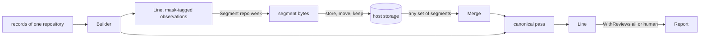
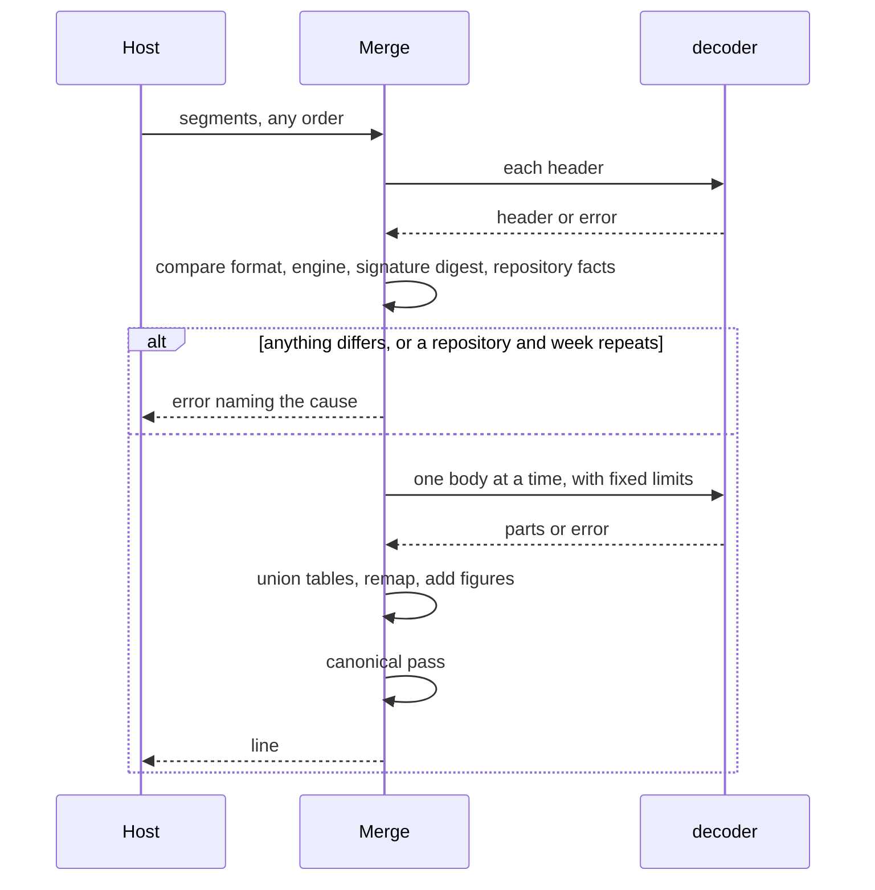

# Plan: Mergeable per-repo, per-week segments for Line

**Branch**: `50-mergeable-line-segments` · **Spec**: [spec.md](spec.md) · **Tasks**: [tasks.md](tasks.md)

## Summary

A built line is cut into one segment per repository and week, and segments merge back into a line whose report is byte equal to a full load. Parity needs four changes to how a line is built: observations that depend on the review mode are kept with the modes they count in, the builder takes its inputs in a total order and the finished line is renumbered canonically so load order stops mattering, coverage and repository figures are kept per repository, and the repository figures are split into parts that add up. The segment is a custom binary encoding under zstd, with the engine version and a digest of the agent signatures in its header. A seeded generator and a scale test give the evidence.

## Technical Context

- **Repo / components**: factorymeter: the measure package, the signature package (one digest method) and a new synth package.
- **Language / version**: Go, the version in the module file.
- **Primary dependencies**: the standard library and the zstd package already in the module graph as an indirect dependency, now direct.
- **Storage**: N/A. The host stores the bytes.
- **Testing**: `go test` and the verify commands listed in CONTRIBUTING.
- **Runs on**: any host that imports the library. Peak memory is read from the process on Linux.
- **Constraints**: public repository, so no customer names and no host internals in code, docs or commits. No new module. Existing reports must not change, except an order that only load order decided.

## Standards Check

| Standard | Applies because | Result |
|---|---|---|
| [security-invariants](https://github.com/marshal-org/atlas/blob/main/standards/security-invariants.md) | the decoder reads bytes a host may not have written | pass: bounded decode, no panics, see Security Aspects |
| [go-conventions](https://github.com/marshal-org/atlas/blob/main/standards/go-conventions.md) | new exported API and a new package | pass |
| Repo CONTRIBUTING | DCO sign-off, conventional commits, no long dashes, no changelog edit | pass: followed on every commit |

## Architecture / HLD

## Implementation Decisions

- **Review mode by tagged observations.** The builder emits the review and merge stations for a change once with every review counted, and again with people only when the change has an agent review. The two outputs are compared stream by stream. An observation or stay that is the same in both is tagged "both", one that differs is tagged "all only" or "human only". A change with no agent review is emitted once and everything is "both". The report reads through a view of the line chosen at report time: a method returns the view for a mode, the view keeps its own parts cache, and a line built with the human-only builder switch is that view. Every raw read of a review stream in the report, the advice and the limits text goes through the view. Rejected: remembering review inputs and deriving at merge, because it repeats the station logic in a second place that must agree. Rejected: two segment sets, because it doubles storage and the cut.
- **Total order of builder inputs.** The builder holds one repository at a time and sorts its inputs into a total order before it classifies: changes by creation time then number, reviews by time then state then author, commits by time then hash, CI runs by creation time then identifier, production deploys by creation time then identifier, and verification deploys the same way. The first-wins and last-wins maps (by commit hash, merge hash and number) are built over that order. This is what removes load order from classification, because those choices are made before any output exists.
- **Canonical pass.** After a build and after a merge the line runs one pass that normalises every time to UTC, sorts and renumbers repositories by lower-cased name, agents by name, items by kind then key then title then URL then class, and flows by repository and name, and then totally orders every stream by time, item, value and the remaining fields. The builder and the merge both end in this pass. If an existing scenario pinned an order that load order alone decided, it changes there only, and the pull request lists each change. Rejected: keeping load order and making tests tolerate it, because that leaves the asterisk the brief removed.
- **Week of an item.** Each item records the moment that places it and its repository: the creation time of a change and the time a deploy finished. A segment selects observations, stays and items by the week of their item. Observations without an item are placed by their own time. Workflow runs are placed by their own time and the repository of their flow.
- **Coverage per repository.** The record creation times and the sources behind them are kept by repository in the line, and the report reads them all together, which gives the same values as today for a full line. A segment carries those of its repository placed by the time of the record, so a merge of some repositories reports only those. Cutting a line that has tickets leaves ticket items, observations and coverage out.
- **Repository figures as parts.** Each figure lands in the week of the thing it counts: changes, merged changes and cut changes by creation, runs and joined runs by the run's creation time, production deploys, ships and ships by commit by the deploy's finish time, joined verifications by the week of their change. Environments are a set and are united. The sync time is the newest. Notes are united, de-duplicated and sorted. Facts about the whole repository, namely private, the sync window start, the signal that runs tell when a runner picked them up, and whether production deploys come from releases, are copied into every segment and must agree. A difference is an error that tells the host to cut the weeks of that repository from one build. Rejected: recomputing the runner-wait signal from per-week counts on merge, because the observations were emitted under the flag of the build, and a recomputed flag on a subset could disagree with them.
- **Repository with no data.** A segment may be empty. `Weeks` lists the weeks with data, and for a repository with none it lists the week of its sync time, so the host always has one segment to cut and the merged line lists the repository.
- **Signature digest and engine version.** The registry gets a digest of its content, stable over map order. The line keeps the digest of the registry its builder used. The engine version is a constant bumped whenever the classification of records changes. Both go in the segment header. The registry's own version field is always 1 and cannot tell lists apart, so it is not used.
- **Segment encoding.** A magic number, the format version, the engine version, the signature digest, the repository name and the week start, then a string table, then items, agents, flows, observations by stream, stays by stream, workflow runs, coverage and sources, and the figures. Integers are variable length, times are exact UTC nanoseconds, floats are the stored bits, and the whole is compressed with zstd at a fixed level so the bytes are stable. Indexes in a segment are local, and merge remaps them. Rejected: a general serialization format, because decode speed and size are what the scale limit tests.
- **Merge.** It checks every header first, then decodes one body at a time. It refuses a mixed format, engine or signature digest, a repeated repository and week with names compared without regard to case, disagreeing repository facts, an empty list and any malformed body. It unions the tables, remaps indexes, adds the figures and ends with the canonical pass. It returns a line in the all-reviews mode with no ticket sources.
- **Bounded decoding.** Each count in a body is checked against the bytes left before anything is allocated, every index against its table, and the decompressed size against a cap and a ratio to the compressed size. The cap is set at several times the largest segment the scale test produces, and the test prints that size so the margin is visible. A decode error is an error value, never a panic.
- **Generator.** A package that holds a seeded source of records for a synthetic organization. The default is 300 repositories, about 1,500 changes a week over the whole organization, and 26 weeks, with reviews by people and by agents, commits including merge commits, CI runs with and without runner times, and production deploys by release and by deployment. It implements the record source interface of the measure package and is deterministic for a seed. It imports the measure package, so every test that uses it is an external test of that package and goes through the exported API only. Rejected: files under a test data directory, because another module cannot import them.
- **Time and memory gate.** A test cuts the segments from the generator one repository at a time and keeps only the bytes, merges all of them, reads a report and asserts the elapsed time and the peak resident memory of the process, read before the full load that follows for the parity check. It runs when an environment switch is set and in the benchmark, so the ordinary suite stays fast and prove runs it. If the memory limit cannot be met, the design is reopened with the operator, not the limit.

## Audit Aspects

None: this is a library with no actors and no stored events. The segment header records the engine version and the signature digest so a host can audit which code and which list cut a segment.

## Security Aspects

- Threat: a host merges bytes it did not cut, or that were damaged in storage. Control: the decoder is bounded and returns errors, and tests with truncations, flipped bytes, huge declared counts and out of range indexes assert no panic and bounded allocation.
- Threat: a compression bomb. Control: a cap on the decompressed size and a ratio to the compressed size, checked before and during decoding.
- Threat: a segment cut under another list of agent signatures silently changes who counts as an agent. Control: the digest is in the header and merge refuses a mix.
- Segments hold the same titles, URLs and logins the line holds. They carry no credentials. A host that stores them treats them as it treats the records. The documentation says so.
- The repository is public. The synthetic names are invented and the generator holds no real data. No customer names or host internals appear in code, docs or commit messages.

## Performance Aspects

- Hot path: decode and merge of 7,800 segments, then one report. The line holds the observations in memory, so memory follows the data of the merged weeks, not of the whole history.
- Budgets: merge and one report in under 10 seconds and under 1 GB of resident memory at 300 repositories and 26 weeks, measured by the scale test from the clock and the process resource usage.
- The canonical pass is one sort per stream and one remap. Decoding allocates the tables once per segment.
- Building does at most twice the emit work for a change, and only for changes that have an agent review. Sorting the inputs adds one sort per repository.

## Testing Decisions

- **Seam**: the marshalled report, plus the drill of a few metrics, which carries times. A parity test builds a line from records, cuts all segments, merges them and compares with the full load, in both review modes. The comparison uses a source that hides tickets, since segments leave them out.
- **Prior art**: the test that records in any order give one report, the scenario tables of the measure tests, and the load tests that build a line from a source.
- Tests that use the generator are in the external test package. Tests that use the scenario helpers are in the internal one.
- Tests are written first and each has a fixed name, listed in tasks, so a row cannot match nothing. Each guard has a mutation check in the pull request: break the guard, see the named test fail, restore. The guards are the review mask, the input order, the canonical sort, the additive figures, the per-repository coverage, the version refusal and the decode bounds.
- Parity runs over the existing scenarios, over a small synthetic organization in every run, and over the full one when the scale switch is set. Exact ties are built by hand.

## Verification

| ID    | Covers                       | Kind   | Command |
|-------|------------------------------|--------|---------|
| G-001 | US1, FR-001, FR-003, SC-001  | unit   | `go test -count=1 -run TestSegmentParityScenarios ./pkg/measure/` |
| G-002 | US1, US2, FR-001, SC-001     | unit   | `go test -count=1 -run TestSegmentParitySynth ./pkg/measure/` |
| G-003 | US2, FR-004, FR-005          | unit   | `go test -count=1 -run TestSegmentReviewModes ./pkg/measure/` |
| G-004 | US1, FR-002, SC-003          | unit   | `go test -count=1 -run TestMergeOrderChangesNothing ./pkg/measure/` |
| G-005 | US1, FR-007, SC-003          | unit   | `go test -count=1 -run TestTiesAreTotal ./pkg/measure/` |
| G-006 | US1, FR-006, FR-011          | unit   | `go test -count=1 -run TestSegmentWeeksAndFigures ./pkg/measure/` |
| G-007 | US3, FR-008, FR-009, SC-004  | unit   | `go test -count=1 -run TestSegmentVersionsAndRefusals ./pkg/measure/` |
| G-008 | US3, FR-010, SC-004          | unit   | `go test -count=1 -run TestSegmentHostileBytes ./pkg/measure/` |
| G-009 | US3, FR-008                  | unit   | `go test -count=1 -run TestSegmentBytesAreStable ./pkg/measure/` |
| G-010 | US4, FR-012                  | unit   | `go test -count=1 ./pkg/synth/` |
| G-011 | US4, SC-001, SC-002          | system | `FACTORYMETER_SCALE=1 go test -count=1 -timeout 20m -run TestMergeScaleGate ./pkg/measure/` |
| G-012 | US4, SC-002                  | system | `go test -run XXX -bench BenchmarkMergeReport -benchtime 1x ./pkg/measure/` |
| G-013 | FR-013, SC-005               | unit   | `go test -count=1 ./...` |
| G-014 | FR-014                       | unit   | `test -f docs/segments.md && grep -q Merge docs/segments.md && grep -q signature docs/segments.md && go doc ./pkg/measure Merge` |
| G-015 | hygiene                      | unit   | `test -z "$(gofmt -l .)" && go vet ./... && go mod tidy && git diff --exit-code go.mod go.sum && scripts/check-dashes.sh` |

G-015 runs on a committed tree, as prove does.

## Test Gaps

None. The scale gate is automated and needs only the environment switch.

## Complexity Tracking

None: no standard is violated.
